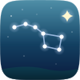
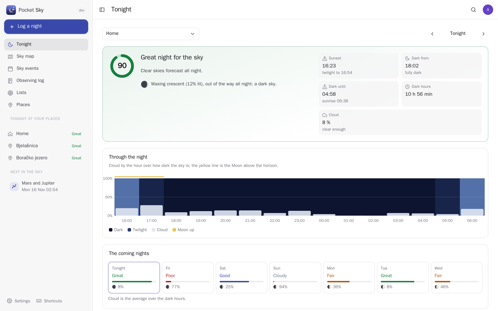
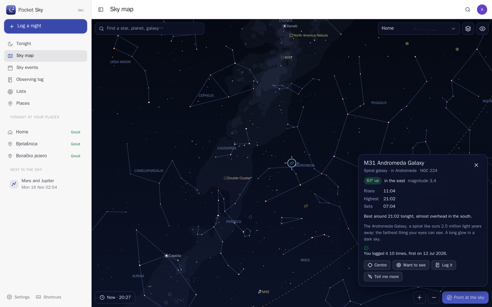
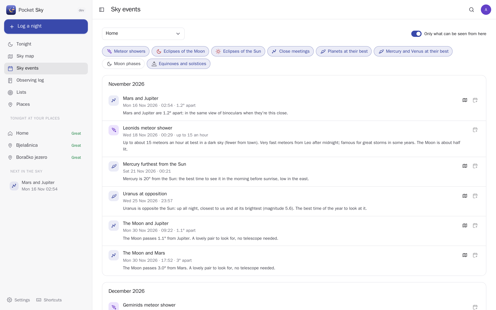
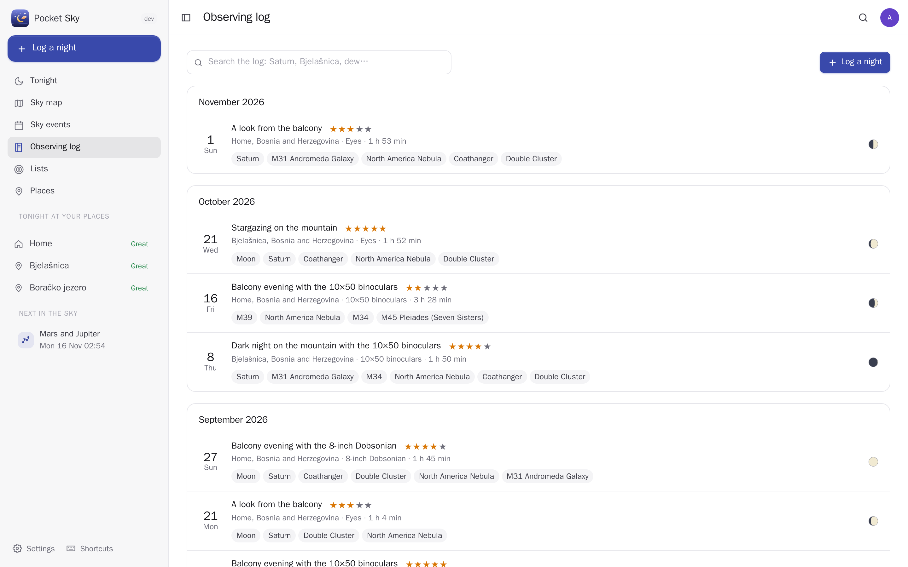
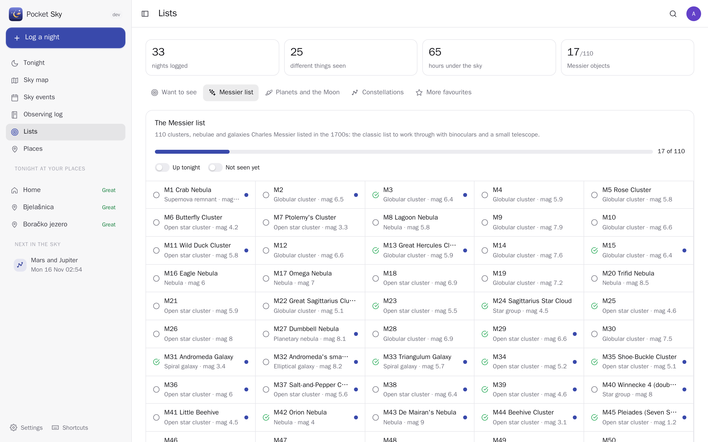
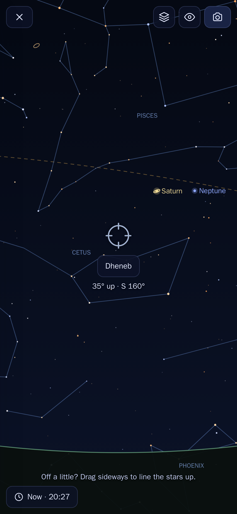
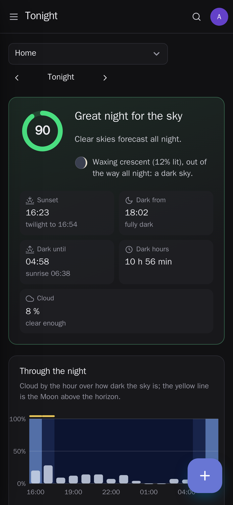

<p align="center"></p>
<h1 align="center">Pocket Sky</h1>
<p align="center">Your night sky: whether tonight will be clear and dark where you are, the Moon, which planets are up and when, and the best sights for your eyes, binoculars or a telescope. A star map you drag around, or hold your phone up and see what you are looking at over the camera. Eclipses, meteor showers and planets meeting, worked out for your place, an observing log and the Messier list to tick off, with Pocket AI to plan the night.<br>One Go binary, one SQLite file, one volume. Part of the Pocket apps; works on its own too.</p>
<p align="center">
  <a href="https://github.com/abjelosevic88/pocket-homelab-sky/actions"></a>
  <a href="https://github.com/abjelosevic88/pocket-homelab-sky/pkgs/container/pocket-homelab-sky"></a>
  <a href="LICENSE"></a>
</p>

---

<p align="center"></p>

<table>
  <tr>
    <td width="50%"></td>
    <td width="50%"></td>
  </tr>
  <tr>
    <td align="center"><sub>The sky map: 5,000 stars, the constellations, the Milky Way, the planets and the Moon in its phase. Tap anything to see what it is and when it is best.</sub></td>
    <td align="center"><sub>Sky events at your place: eclipses (with whether you can see them), meteor showers, the Moon passing the planets, planets at their best.</sub></td>
  </tr>
  <tr>
    <td width="50%"></td>
    <td width="50%"></td>
  </tr>
  <tr>
    <td align="center"><sub>The observing log: each night out, what you saw, with what, and how the sky was.</sub></td>
    <td align="center"><sub>Your lists tick themselves off: want to see, the Messier list, the planets, the 88 constellations.</sub></td>
  </tr>
  <tr>
    <td width="50%"></td>
    <td width="50%"></td>
  </tr>
  <tr>
    <td align="center"><sub>Point at the sky: the map follows the phone's compass and tilt, with the camera picture behind the stars.</sub></td>
    <td align="center"><sub>Made for the phone; light and dark follow the system, and red light keeps your night vision.</sub></td>
  </tr>
</table>

## What it does

- **Tonight**: sunset, twilight and the dark hours, the cloud forecast by the hour (low, middle and high), the Moon and when it is out of the way, a rating for the night and the next seven nights.
- **Planets and sights**: every planet with when, where and how bright; the best clusters, nebulae and galaxies for how dark your place is (the Bortle scale), marked eyes, binoculars or telescope.
- **The sky map**: drag to look around, pinch or scroll to zoom, search anything, move the time to any hour of any night. Constellation lines and names, star names, deep-sky objects, the Milky Way, the Sun's path and grids, each switchable; red light for the dark.
- **Point at the sky**: hold your phone up and the map follows its compass and tilt, over the camera picture or on its own; drag sideways if the compass is off, pinch to match the camera. Needs HTTPS.
- **Sky events**: Moon phases and supermoons, equinoxes and solstices, conjunctions, oppositions, Mercury and Venus at their best, meteor shower peaks with the Moon's light that year, and eclipses of the Moon and the Sun with their times at your place. Each can go on your Pocket Calendar.
- **The observing log**: date, place, time, equipment, seeing, transparency, cloud, a rating, notes and what you saw (one tap for what was up that night). It ticks off your want-to-see list, the Messier list, the planets and the constellations.
- **An evening message** (Apprise, ntfy or a webhook) when a clear, dark night is coming at your places, and on the day of the events you choose.
- **Everyone their own**: places, log, lists, settings and connections per person; admins see no one else's. Export as JSON (and back in) or the log as CSV.

The engine is Paul Schlyter's method with the main perturbations, checked against astronomy-engine to a few arc minutes; the server (Go) and the map (TypeScript) answer the same test vectors.

## Run it

```sh
docker run -d --name pocket-sky -p 8080:8080 -v ./data:/data \
  -e BASE_URL=https://sky.example.com -e SECURE_COOKIES=true \
  ghcr.io/abjelosevic88/pocket-homelab-sky:latest
```

or `docker compose up -d` with [docker-compose.yml](docker-compose.yml). Open it, create the first account and add where you watch the sky from. The camera, the compass and "use where I am" need HTTPS (or localhost). All options: [docs/configuration.md](docs/configuration.md). API: [docs/api.md](docs/api.md).

## With Pocket Core

Set `CORE_URL` and `CORE_REGISTRATION_KEY` and Sky joins the box: people sign in with Pocket Core, and through app links each person's Sky reaches their own Pocket apps with nothing to paste:

| App | What Sky does there | Scopes |
|---|---|---|
| Pocket Calendar | Add to calendar on a sky event or a night out | `calendar:write` |
| Pocket Weather | take the places you follow over as places to watch the sky from | `weather:read` |
| Pocket Places | take a saved viewpoint or dark field over as a place | `places:read` |
| Pocket Notes | save a night of the log as a note (folder Sky) | `notes:write` |
| Pocket AI | plan the night in plain words, explain anything on the map, the Ask button on every page | inference |

Other apps can read your sky (`sky:read`: tonight, the coming nights, events, positions, your log and lists — for Pocket Day, Pocket AI and dashboards) or log a night (`sky:write`). Events on the bus: `sky.clear_night`, `sky.event`, `sky.observation.logged`. Without Core every connection can be made directly with a URL and a token; the Core-only choices stay visible, greyed out.

Sky also tells Core what it can do for the apps that bring everything together, so they find it on their own (it sits under Places):

| Asked by | What they get | Scope |
|---|---|---|
| Pocket Search (`!sky`, `!stars`, `!astro`) | your log entries, plans, want-to-see list and equipment, and anything in the sky by name | `pocket:search` |
| Pocket Day | the nights you logged and what you saw, the plans for that night and the sky events of the day | `pocket:day` |
| Pocket Hub, a widget | Tonight's sky: when it gets dark, the Moon, the best things to look at and your next plan | `pocket:widget` |
| Pocket Hub, a quick line | "Saw Jupiter's moons, clear sky" becomes an entry in your observing log | `pocket:capture` |

Each scope opens one route ([docs/api.md](docs/api.md)) and nothing else, and only your own things come back. The widget and the day never wait for a forecast: they show the cloud only when Sky already has a recent one.

## Develop

```sh
make dev     # API on :8080 with demo data (a made-up cloud forecast, no network) + Vite on :5173
make test    # go vet, go test, tsc, and the engine vectors in the browser engine
make         # web + binary
python3 scripts/catalog.py DIR   # rebuild the star catalogue from d3-celestial's data
```

MIT licensed. Stars, constellations and the Milky Way from [d3-celestial](https://github.com/ofrohn/d3-celestial) (BSD 3-Clause; Hipparcos/XHIP, IAU, SEDS) — see [NOTICE](NOTICE). Cloud forecast by [Open-Meteo.com](https://open-meteo.com) (CC BY 4.0); place names © [OpenStreetMap](https://www.openstreetmap.org/copyright) contributors.
